<div align="center">

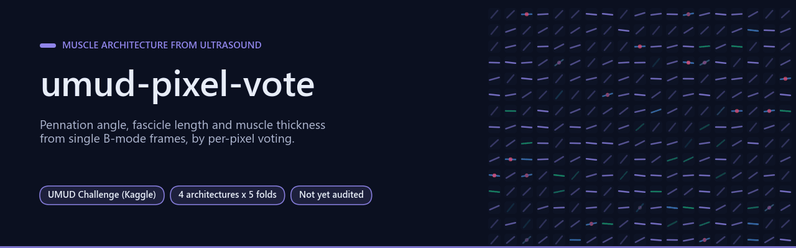

# umud-pixel-vote — muscle architecture from ultrasound by per-pixel voting

[](LICENSE)  [](RESULTS.md)   [](https://www.kaggle.com/competitions/umud-challenge-muscle-architecture-in-ultrasound-data)

[**Results**](#results) · [**The problem**](#the-problem-and-why-it-is-not-just-segmentation) · [**Reproducing**](#reproducing) · [**Observations**](#observations) · [**Full results**](RESULTS.md) · [**Bibliography**](#bibliography)

</div>

Automatic estimation of **pennation angle (PA)**, **fascicle length (FL)** and **muscle
thickness (MT)** from single B-mode ultrasound frames, for the
[UMUD Challenge: Muscle Architecture in Ultrasound Data](https://www.kaggle.com/competitions/umud-challenge-muscle-architecture-in-ultrasound-data)
(Swissuniversities, Kaggle, closes 2026-11-14).

Author: Francisco Angulo de Lafuente ([Agnuxo1](https://github.com/Agnuxo1)).
License: **GPL-3.0** (the licence the competition requires of winning submissions).

**Contents** — [Results](#results) · [The problem, and why it is not just segmentation](#the-problem-and-why-it-is-not-just-segmentation) · [Background](#background) · [What this repository contains](#what-this-repository-contains) · [The hypothesis under test: NeuroPixel as a per-pixel voting field](#the-hypothesis-under-test-neuropixel-as-a-per-pixel-voting-field) · [Reproducing](#reproducing) · [Attribution](#attribution) · [Observations](#observations) · [Real-world applications](#real-world-applications) · [Possible improvements](#possible-improvements) · [Future work](#future-work) · [Bibliography](#bibliography)

## Results

<p align="center">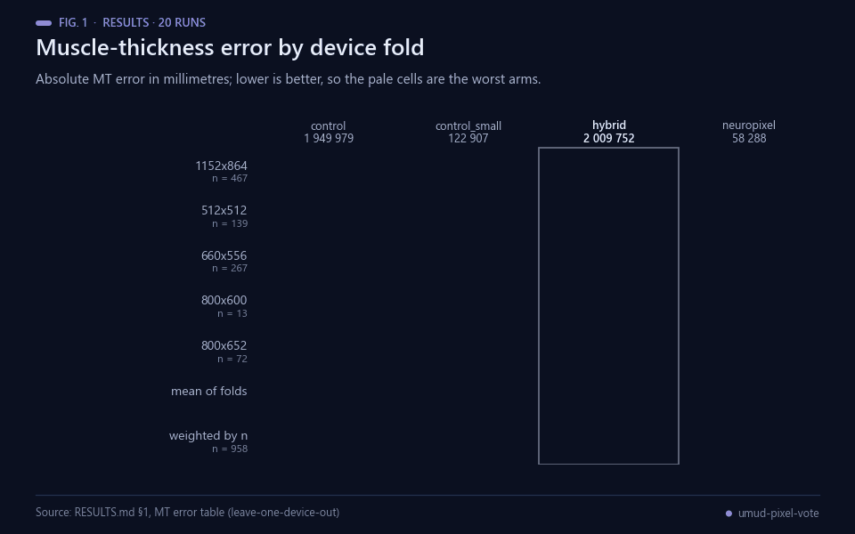<br><sub>Fig. 1 — MT error by fold, lower is better. Data: RESULTS.md §1.</sub></p>

20 runs completed: 4 architectures x 5 leave-one-device-out folds, paired by fold, with the
epoch picked on a **second** held-out device so the reported group is never seen during
training.

- **The NeuroPixel layer does help.** The hybrid beats the U-Net control on MT in **4 of 5**
  folds (4.63 mm against 4.90 mm on average) and on the mask-referenced angle in **4 of 5**, and
  it is the best of the four arms on three of the four summary measures. Added through a
  zero-initialised gate, at step 0 it *is* the control, so the difference is attributable to the
  layer alone.

<p align="center">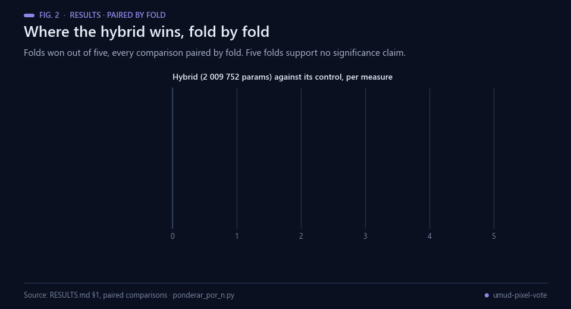<br><sub>Fig. 2 — Folds won, paired by fold. Data: RESULTS.md §1 and ponderar_por_n.py.</sub></p>

- **The margin survives weighting.** The folds are device groups ranging from 13 to 467
  images. Weighted by images instead of by fold the MT margin **widens**, 0.27 mm to 0.41 mm,
  because the hybrid gains most on the largest group; dropping every fold under 50 images
  still leaves 3 of 4 wins.
- **NeuroPixel alone localises badly and orients well**: worst of the four on MT, but on the
  angle measured inside the true mask it beats its **capacity-matched** control in 3 of 5 folds
  with a paired median of −0.40 deg, using 58 k parameters against that control's 123 k. It
  does *not* beat the large arms once they are paired by fold — see the correction in
  [`RESULTS.md`](RESULTS.md) §1.
- **The scale is recovered from the scanner's own ruler, without OCR**, on 93.9 % of training
  and 80.9 % of test images, with a 0.29 % median ratio error where both rulers are legible.
- **The geometry stage is verified against a constructed case** with a known answer: MT exact to
  20.00 mm, the orientation of a 1 px line to within 0.1 deg.

<p align="center">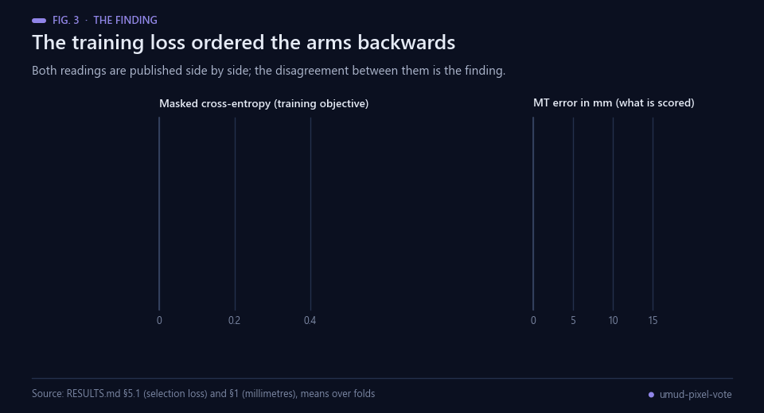<br><sub>Fig. 3 — The two readings side by side. Data: RESULTS.md §5.1 and §1.</sub></p>

The finding worth reading first: **the training loss ordered the arms backwards.** By masked
cross-entropy the hybrid looked worse in 4 of 5 folds; in millimetres and degrees — what the
competition pays — it is better in 4 of 5. Selecting and concluding by the loss, the normal
thing to do, would have published the opposite verdict.

Full numbers, the protocol, and the limits of each figure: [`RESULTS.md`](RESULTS.md).

## The problem, and why it is not just segmentation

<p align="center">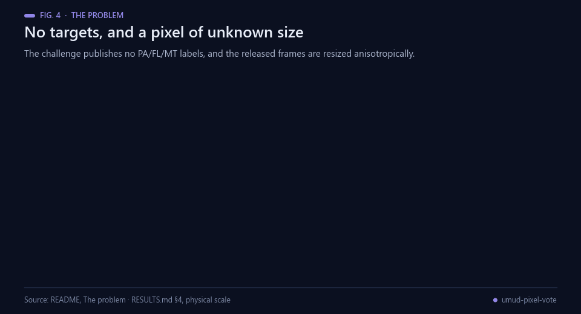<br><sub>Fig. 4 — Why geometry comes before modelling. Data: README and RESULTS.md §4.</sub></p>

The challenge publishes **no PA/FL/MT labels at all**: the training set contains 1048
aponeurosis masks and 2761 fascicle masks, and **no image carries both kinds**. The targets
are in millimetres and degrees, while the released images have been **resized anisotropically**
(most to 1200x800) with the masks kept at the native frame size. So before any geometry is
possible, the **physical scale of each axis has to be recovered from the image itself**.

## Background

<p align="center">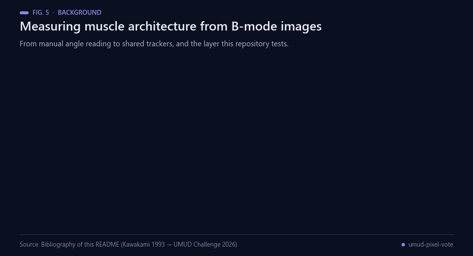<br><sub>Fig. 5 — Milestones behind this work. Sources: bibliography below.</sub></p>

Muscle architecture has been read off B-mode ultrasound for three decades. Kawakami and colleagues measured
fibre pennation in vivo in 1993, reporting angles between 9 and 53 degrees and a correlation between pennation
and muscle thickness [[2](#ref-2)]; a systematic review of 36 reliability and 6 validity studies later put
two-dimensional ultrasound measurement of fascicle length and pennation on a measured footing, with intraclass
correlations above 0.6 and coefficients of variation below 10 % [[3](#ref-3)], and a later review set out the
strengths and shortcomings of the in vivo imaging techniques in use [[4](#ref-4)]. Automation followed the manual
protocol: automated tracking of fascicle orientation in B-mode images [[5](#ref-5)], automatic tracking of fascicle
length through locomotion [[6](#ref-6)], the DL_Track_US package for analysing muscle ultrasonography images with
deep learning [[7](#ref-7)], UltraTimTrack, which combines the fascicle length and angle estimates of two existing
open algorithms through a Kalman filter to track without drift and with low noise [[8](#ref-8)], and DUSTrack,
which pairs deep learning with optical flow to track arbitrary points in B-mode video [[9](#ref-9)]. The UMUD
Challenge asks for the same three quantities from *single* frames, scored in millimetres and degrees on a
device absent from training [[1](#ref-1)].

The architectural question this repository tests comes from a different line. Segmentation networks reach
context by down-sampling and up-sampling [[10](#ref-10)]; dilated convolutions were introduced to aggregate
multi-scale context *without* losing resolution [[11](#ref-11)]; neural cellular automata let every cell decide its
next state from its neighbours alone, with the update rule learned [[12](#ref-12)]; and discrete-codebook models
show that a representation can be a choice among the entries of a shared, learned dictionary [[13](#ref-13)]. The
author's NeuroPixel keeps the whole neural state on a spatial canvas and reads it through a learned dictionary
[[14](#ref-14)]. `NeuroPixelField` is those three pieces applied to one task, and the hybrid adds them to a U-Net
control through a zero-initialised gate so the comparison isolates the layer.

The protocol follows from what this data is. The folds are device groups, and cross-validation that ignores
structure in the data underestimates predictive error, which is why whole devices are held out rather than
random rows [[16](#ref-16)]; the discarded device-fingerprint path in `RESULTS.md` §5.3 is a textbook case of
leakage, where an identifier carries the answer it is supposed to predict [[17](#ref-17)]; and the disagreement
between the training loss and the scored quantity is the kind of metric pitfall a recent community consensus
catalogues [[15](#ref-15)].

## What this repository contains

| module | role |
|---|---|
| `roi_scale.py` | physical scale (px/mm per axis) **without OCR**: finds the scanner's ruler by the regularity of its tick train (multiscale band sweep with a sliding maximum), rejects text columns by peak width, ink fraction and brightness uniformity, and picks the tick value (1/2/5/10 mm) **once for both rulers**, since the scanner prints a single scale |
| `geometria.py` | the challenge's own annotation procedure, in code: MT as the perpendicular distance between the two aponeuroses at three sites, PA as the fascicle angle relative to the **deep** aponeurosis in metric space, FL = MT / sin(PA) (the linear extrapolation the annotators use) |
| `modelos.py` | four bodies with one identical head: a 1.95 M U-Net control (an smp ResNet-34 is tried first and the fallback now says out loud when it is not available), a capacity-matched 123 k small control, `NeuroPixelField` (58 k), and the hybrid |
| `train.py` | one vocabulary, partial supervision per image, leave-**two**-devices-out: one group picks the epoch, another is reported and is never evaluated during training |
| `infer.py` | votes to millimetres and degrees; the geometry stage is identical for every model, so the ablation isolates the contribution of the own layer |
| `ponderar_por_n.py` | rereads the ablation weighting each fold by its image count, and reports every comparison paired by fold — the folds range from 13 to 467 images, so a mean over folds and a mean over images are not the same number |
| `run_semillas.py` | seed spread **inside** a fixed fold: `train.py` derives the fold from the seed, so the published run has one seed per fold and no measure of initialisation noise. This pins `--val-group`, moves only the seed, and refuses to report if the cells do not share a fold |

## The hypothesis under test: NeuroPixel as a per-pixel voting field

<p align="center">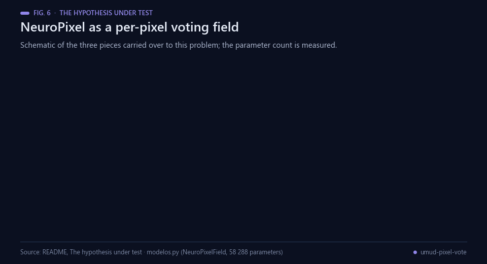<br><sub>Fig. 6 — Schematic of the layer under test; the parameter count is measured (modelos.py).</sub></p>

[NeuroPixel](https://github.com/Agnuxo1) keeps the whole neural state on a spatial canvas.
`NeuroPixelField` carries its three defining pieces over to this problem:

1. a **retina** of dilated convolutions (rates 1, 2, 4, 8; receptive field about 31 px) that
   gives every pixel an identity vector **without ever reducing resolution**;
2. a **neural cellular automaton** — depthwise 3x3 perception plus a 1x1 residual MLP with a
   stochastic fire rate — so line structure propagates by iteration between neighbours instead
   of by down- and up-sampling;
3. a **tied-dictionary read applied to every pixel**, which is literally each pixel casting a
   vote for one word of a shared dictionary.

<p align="center">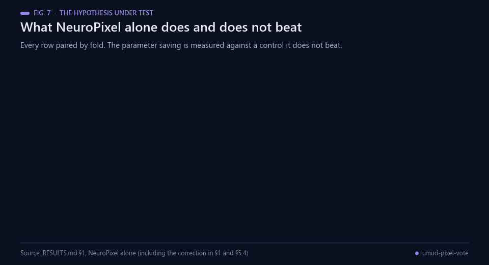<br><sub>Fig. 7 — What NeuroPixel alone does and does not beat, paired by fold. Data: RESULTS.md §1.</sub></p>

Here the dictionary is `{background, superficial aponeurosis, deep aponeurosis}` plus
twenty-four fascicle-orientation bins, with a probability-weighted circular mean interpolating
inside the bin. `NeuroPixelField` has **58 288** parameters against **1 949 979** for the U-Net
control that actually ran; parameter counts are reported next to every metric, and the tables
state which body each arm used.

## Reproducing

<p align="center">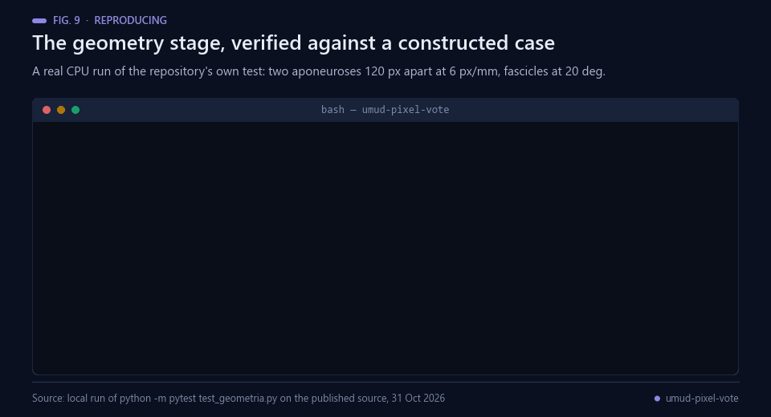<br><sub>Fig. 8 — A real CPU run of test_geometria.py on the published source, 31 Oct 2026.</sub></p>

The competition data is distributed under CC BY-NC-SA and **may not be redistributed**, so it
is not included here. Download it from the competition page, then:

```bash
pip install -r requirements.txt
python prep_dataset.py          # compact 384x256 working set + per-image physical scale
python run_all.py               # 4 architectures x 5 device folds
python infer.py --ckpt runs/neuropixel_s0.pt --split test --out submission.csv
```

Data locations are read from the environment, so nothing is hard-coded to one machine:

```bash
export UMUD_RAW=/path/to/competition/data      # the unzipped competition folder
export UMUD_WORK=/path/to/scratch              # where the working set and CSVs are written
```

## Attribution

- Official metric and the `DL_Track_US 0.3.1` aponeurosis notebook: the competition organizers
  (Paul Ritsche et al.).
- Domain algorithms cited as prior art: [DL_Track_US](https://github.com/PaulRitsche/DL_Track_US),
  [UltraTimTrack](https://github.com/timvanderzee/UltraTimTrack),
  [DUSTrack](https://github.com/praneethnamburi/DUSTrack).
- Public Kaggle notebook `watehell/ans-is-simple-physical-scale-u-net-geometry` established that
  per-axis physical scale is the dominant factor and recovers it by OCR of the depth label plus
  ruler ticks. The estimator here is an independent, OCR-free reimplementation with explicit
  physiological validation; the competition rules allow reuse of existing code in an improved
  version, and the idea is credited here.

## Observations

<p align="center">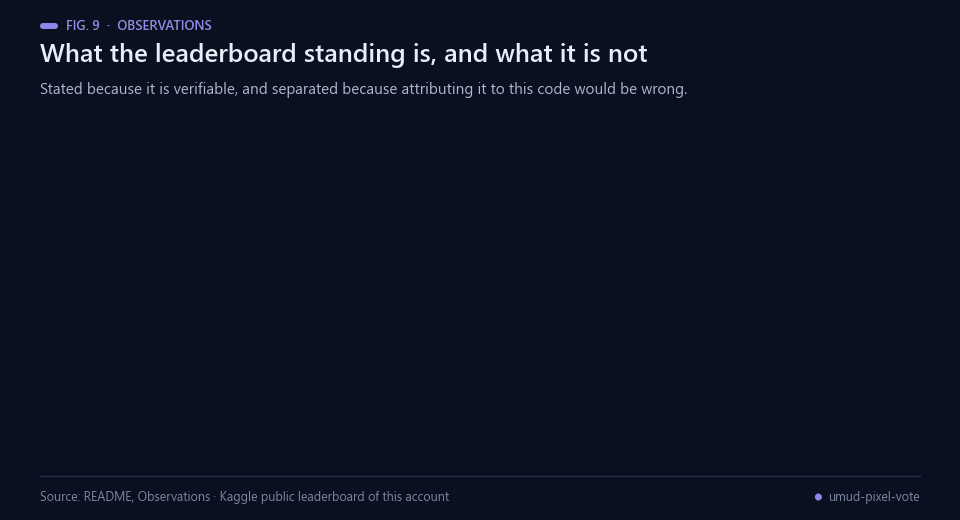<br><sub>Fig. 9 — The standing, and what it is not. Data: README, Observations.</sub></p>

**On the leaderboard.** The public leaderboard is computed on roughly 102 images and has
received over 15 000 submissions, while the private test set contains an ultrasound device and
a patient population absent from training. Nothing here is calibrated against the public
leaderboard, and the organizers' own final criterion — whether the submission can be re-run on
a new dataset where no leaderboard exists — is treated as binding.

**On this account's standing, so it is not misread.** The account holds 5 submissions and sits
at **rank 32 of 547** on the public leaderboard with 0.24237. None of them came from this
repository: they are averages of other participants' public notebooks, and **the pipeline in this
repository has never been submitted**, so its score on the competition's test set is unknown. The
rank is stated here because it is verifiable and because attributing it to this code would be
wrong. By the organizers' re-runnability criterion the relationship is the other way round: the
averaged notebooks are the hard thing to defend, and this pipeline — scale from the image's own
ruler, the annotation geometry in code, nothing fitted to the leaderboard — is the defensible one.

<p align="center">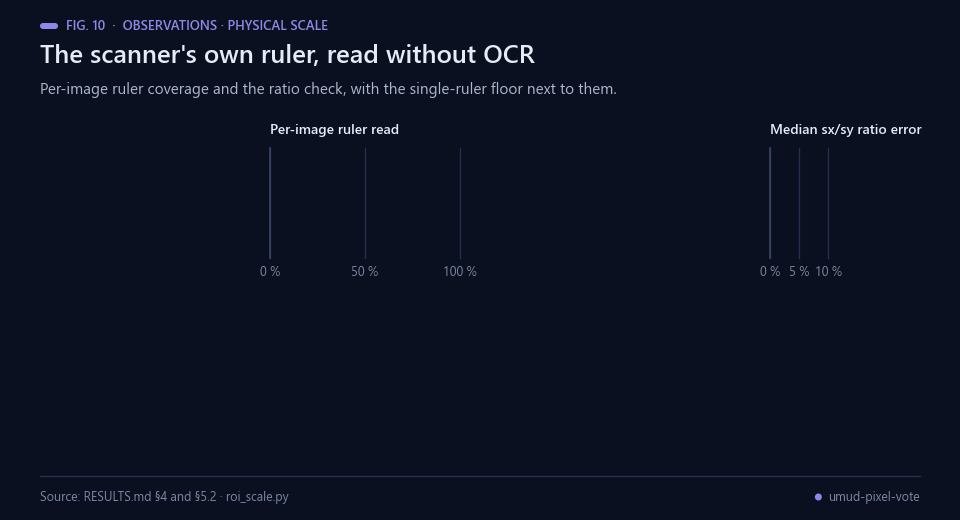<br><sub>Fig. 10 — Physical scale recovered from the image. Data: RESULTS.md §4 and §5.2.</sub></p>

**On the figures above.** None of them is the official metric, which needs labels the
competition does not publish for the test set; MT is measured against the masks and the angle
against the masks' dominant orientation. Because 88.3 % of test images show a single legible
ruler and fall back to isotropy, every millimetre and degree here is an optimistic upper bound
on what the test set would give.

**On the loss.** The quantity the training minimises ranks the arms the other way round: by
masked cross-entropy the hybrid is worse than the control in 4 of 5 folds and NeuroPixel alone
is worse than all three others in 5 of 5. Both readings are published side by side in
`RESULTS.md`; the disagreement between them is the finding, and nothing here claims the loss
agrees.

<p align="center">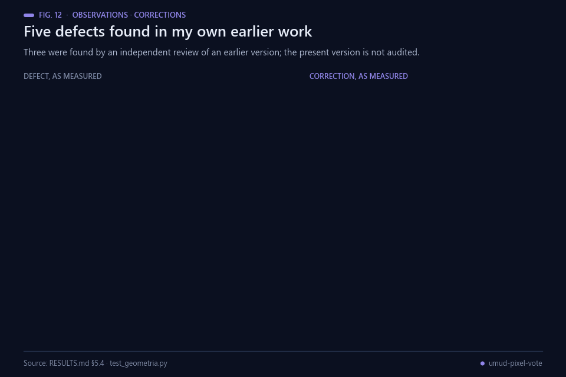<br><sub>Fig. 12 — Corrections to the author's own earlier work. Data: RESULTS.md §5.4.</sub></p>

**On the audit.** An earlier version of these documents was refuted by an independent review,
which is how three of the recorded defects were found. The present version has **not yet been
independently audited**; an audit is scheduled before the competition closes.

<p align="center">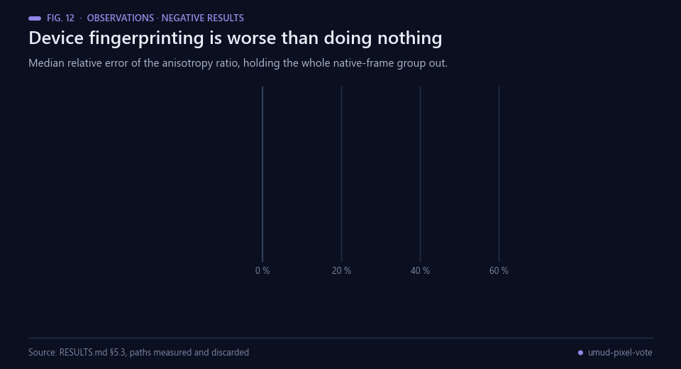<br><sub>Fig. 11 — A measured negative: fingerprinting is worse than doing nothing. Data: RESULTS.md §5.3.</sub></p>

**On negative results.** They are kept rather than dropped, including the ones that refuted
earlier claims of my own: four statements previously published in this repository were wrong
and are recorded as such, next to the measurements that refuted them — three found by the
independent review, the fourth found here by pairing a mean I had reported unpaired. Section 5
of [`RESULTS.md`](RESULTS.md) collects them, together with the three paths that were measured
and discarded for being no better than the trivial alternative.

**On what is still unmeasured.** There is no measure of seed spread in this repository. Because
`train.py` derives the reported fold from the seed, the five "seeds" of the published run are
the five device folds, one seed each, and the margins above are therefore not known to exceed
initialisation noise. `run_semillas.py` is the experiment that answers it and is queued on a
private GPU server behind other work; if it has not run by the time the audit does, the
statement stands as it is written here.

## Real-world applications

<p align="center">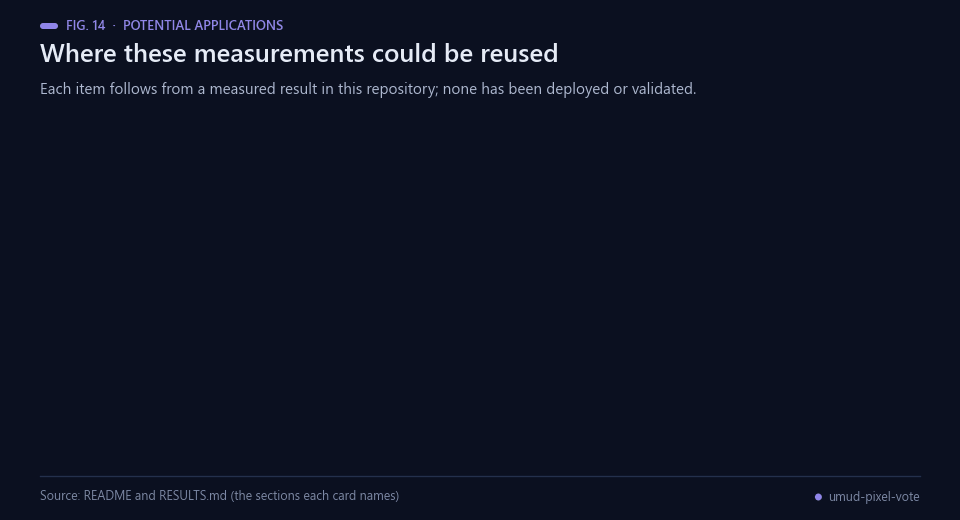<br><sub>Fig. 13 — Potential reuse. Nothing here has been deployed or clinically validated.</sub></p>

None of the following has been built, deployed or validated; each is a use that the measurements in this
repository would support if someone took it up.

- **Recovering the scale before modelling.** Pipelines that read resized ultrasound frames could read the
  per-axis scale from the scanner's own ruler instead of assuming an isotropic pixel. Here the ruler is read on
  93.9 % of training and 80.9 % of test images without OCR, and where both rulers are legible the ratio error
  has a median of 0.29 %.
- **Judging a layer in the unit the task is scored in.** The loss ordered the four arms backwards with respect
  to millimetres and degrees, which is exactly the class of pitfall catalogued for validation metrics
  [[15](#ref-15)]; reporting the physical unit alongside the objective costs nothing and would have changed the
  verdict here.
- **Small orientation read-outs.** The orientation head runs at 58 288 parameters and beats its
  capacity-matched control inside the true mask in 3 of 5 folds, which may suit constrained hardware — but only
  where localisation is supplied by something else, since on muscle thickness it is the worst of the four arms
  in all five folds.
- **Protocols that hold out whole devices.** A new scanner is what the private test set imposes, and grouped
  hold-out is the validation that matches it [[16](#ref-16)]. The fingerprint result shows concretely what a random
  split would have hidden [[17](#ref-17)].
- **Annotation geometry as a reference implementation.** The challenge's own procedure — perpendicular
  thickness at three sites, the fascicle angle relative to the deep aponeurosis in metric space, FL = MT /
  sin(PA) — is in code and verified against a constructed case to 0.1 degrees, so it can be reused where
  reliability of manual reading is the limiting factor [[3](#ref-3), [4](#ref-4)].
- **Published negative results.** The discarded paths carry their numbers, so other entrants can skip them
  rather than measure them again; the same openness is what the maintained ultrasound packages have given the
  field [[7](#ref-7)].

## Possible improvements

<p align="center">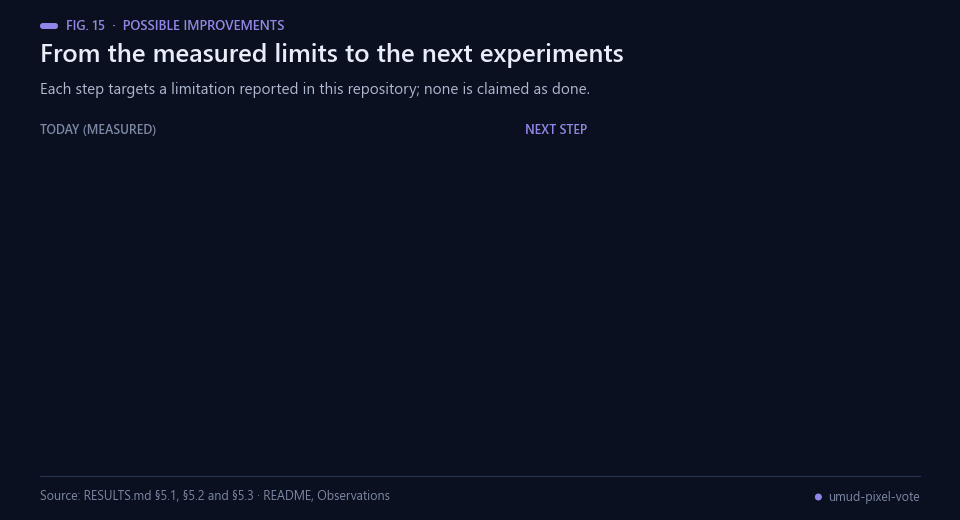<br><sub>Fig. 14 — Each improvement targets a limitation reported in this repository.</sub></p>

- **Measure the seed spread first.** `train.py` derives the reported fold from the seed, so the five "seeds" of
  the published run are the five device folds with one seed each. Until `run_semillas.py` runs, the 0.26 mm
  paired median on muscle thickness is not known to exceed initialisation noise, and no amount of further
  architecture work is worth more than settling that.
- **Build the isotropy detector, not a better estimator.** 88.3 % of test images show a single legible ruler and
  fall back to isotropy, at an 11.1 % median ratio error. The spectral estimator wins on the median and the p90
  and loses on the mean, and the Nyquist peak reaches 100 % precision at only 17.3 % recall: what is missing is
  recall on the detector.
- **Give the orientation head a localiser.** NeuroPixel alone is the worst of the four arms on muscle thickness
  in all five folds, by +9.0 mm of median difference. Pairing its orientation read-out with a model that finds
  the aponeuroses, under a protocol fixed before the run, is the experiment its measured niche suggests.
- **Find data where fascicle length can be measured.** No image in this release carries both mask types, so FL
  is only bounded. Any conclusion about FL needs a source where the two coexist.
- **Fix the protocol before the next comparison, and report both readings.** The loss and the millimetres
  disagree here, and the honest handling is to pre-register which one decides [[15](#ref-15)] and to keep whole
  devices out of training when validating [[16](#ref-16)].

## Future work

<p align="center">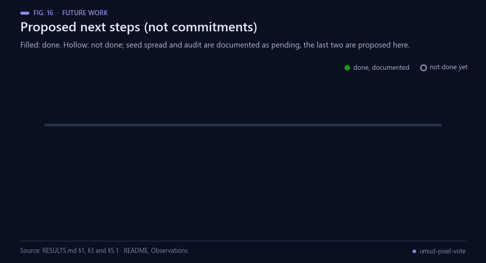<br><sub>Fig. 15 — The two filled markers are documented in this repository; the rest are proposals.</sub></p>

Proposed next steps, not commitments. Only the first two are documented in this repository as done; the others
are proposals and none is claimed as started:

1. *Documented.* The geometry stage is verified against a constructed case, including a 1 px line to 0.1
   degrees (`test_geometria.py`).
2. *Documented.* The 20-run ablation, 4 architectures across 5 leave-one-device-out folds, with the epoch
   chosen on a second held-out device.
3. Run the seed experiment `run_semillas.py` — same fold, further seeds — and publish whatever it says about
   the margins in §1, including if it says they do not survive.
4. Put the present documents through the independent audit the repository says is scheduled before the
   competition closes.
5. Submit the pipeline itself, so that its score on the competition's test set stops being unknown
   [[1](#ref-1)].
6. Repeat the ablation on a source where both mask types coexist, so fascicle length is measured rather than
   bounded.

## Bibliography

1. <a id="ref-1"></a>UMUD Challenge organizers (2026). *UMUD Challenge: Muscle Architecture in Ultrasound Data* (Kaggle competition, swissuniversities). https://www.kaggle.com/competitions/umud-challenge-muscle-architecture-in-ultrasound-data
2. <a id="ref-2"></a>Kawakami, Y., Abe, T., & Fukunaga, T. (1993). Muscle-fiber pennation angles are greater in hypertrophied than in normal muscles. *Journal of Applied Physiology*, 74(6), 2740–2744. https://doi.org/10.1152/jappl.1993.74.6.2740
3. <a id="ref-3"></a>Kwah, L. K., Pinto, R. Z., Diong, J., & Herbert, R. D. (2013). Reliability and validity of ultrasound measurements of muscle fascicle length and pennation in humans: a systematic review. *Journal of Applied Physiology*, 114(6), 761–769. https://doi.org/10.1152/japplphysiol.01430.2011
4. <a id="ref-4"></a>Franchi, M. V., Raiteri, B. J., Longo, S., et al. (2018). Muscle Architecture Assessment: Strengths, Shortcomings and New Frontiers of in Vivo Imaging Techniques. *Ultrasound in Medicine & Biology*, 44(12), 2492–2504. https://doi.org/10.1016/j.ultrasmedbio.2018.07.010
5. <a id="ref-5"></a>Rana, M., Hamarneh, G., & Wakeling, J. M. (2009). Automated tracking of muscle fascicle orientation in B-mode ultrasound images. *Journal of Biomechanics*, 42(13), 2068–2073. https://doi.org/10.1016/j.jbiomech.2009.06.003
6. <a id="ref-6"></a>Cronin, N. J., Carty, C. P., Barrett, R. S., & Lichtwark, G. (2011). Automatic tracking of medial gastrocnemius fascicle length during human locomotion. *Journal of Applied Physiology*, 111(5), 1491–1496. https://doi.org/10.1152/japplphysiol.00530.2011
7. <a id="ref-7"></a>Ritsche, P., Seynnes, O., & Cronin, N. (2023). DL_Track_US: a python package to analyse muscle ultrasonography images. *Journal of Open Source Software*, 8(85), 5206. https://doi.org/10.21105/joss.05206
8. <a id="ref-8"></a>van der Zee, T. J., Tecchio, P., Hahn, D., & Raiteri, B. J. (2025). UltraTimTrack: a Kalman-filter-based algorithm to track muscle fascicles in ultrasound image sequences. *PeerJ Computer Science*, 11, e2636. https://doi.org/10.7717/peerj-cs.2636
9. <a id="ref-9"></a>Namburi, P., Pallarès-López, R., Rosendorf, J., Folgado, D., & Anthony, B. W. (2026). DUSTrack: Semi-automated point tracking in ultrasound videos. *Scientific Reports*, 16(1). https://doi.org/10.1038/s41598-026-42795-3
10. <a id="ref-10"></a>Ronneberger, O., Fischer, P., & Brox, T. (2015). U-Net: Convolutional Networks for Biomedical Image Segmentation. *arXiv* 1505.04597. https://arxiv.org/abs/1505.04597
11. <a id="ref-11"></a>Yu, F., & Koltun, V. (2015). Multi-Scale Context Aggregation by Dilated Convolutions. *arXiv* 1511.07122. https://arxiv.org/abs/1511.07122
12. <a id="ref-12"></a>Mordvintsev, A., Randazzo, E., Niklasson, E., & Levin, M. (2020). Growing Neural Cellular Automata. *Distill*, 5(2). https://doi.org/10.23915/distill.00023
13. <a id="ref-13"></a>Oord, A. v. d., Vinyals, O., & Kavukcuoglu, K. (2017). Neural Discrete Representation Learning. *arXiv* 1711.00937. https://arxiv.org/abs/1711.00937
14. <a id="ref-14"></a>Angulo de Lafuente, F. (2026). *NeuroPixel: a neural network that thinks in pixels* (source code). https://github.com/Agnuxo1/NeuroPixel
15. <a id="ref-15"></a>Reinke, A., Tizabi, M. D., Baumgartner, M., et al. (2024). Understanding metric-related pitfalls in image analysis validation. *Nature Methods*, 21(2), 182–194. https://doi.org/10.1038/s41592-023-02150-0
16. <a id="ref-16"></a>Roberts, D. R., Bahn, V., Ciuti, S., et al. (2017). Cross‐validation strategies for data with temporal, spatial, hierarchical, or phylogenetic structure. *Ecography*, 40(8), 913–929. https://doi.org/10.1111/ecog.02881
17. <a id="ref-17"></a>Kaufman, S., Rosset, S., Perlich, C., & Stitelman, O. (2012). Leakage in data mining. *ACM Transactions on Knowledge Discovery from Data*, 6(4), 1–21. https://doi.org/10.1145/2382577.2382579

---

<div align="center">
<sub>Built by <a href="https://github.com/Agnuxo1">Francisco Angulo de Lafuente</a> · every figure is an animated
rendering of the published file named in its footer · <a href="#umud-pixel-vote--muscle-architecture-from-ultrasound-by-per-pixel-voting">back to top ↑</a></sub>
</div>
